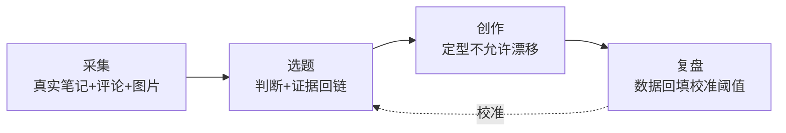

# MBTI 自媒体工作台

> 一个本地运行的小红书内容工作台：把「选题判断」从聊天框里的玄学，做成可回溯、可核查、可回退的流水线。

不是又一个「AI 帮你写小红书文案」的套壳。它要解决的是一个更具体的问题：**你凭什么认为这个选题值得写？**

---

## 它解决的问题

做垂类账号（这里是 MBTI 方向）时，真正的瓶颈从来不是「写不出来」，而是：

- 选题靠感觉，写完才发现没人关心
- 参考了别人的爆款，写出来却是二手转述
- AI 给的选题听起来都对，但追问「凭什么」就哑了

这个工作台把这套判断拆成四段，每段都留下证据：



---

## 四个台子

| 台子 | 干什么 |
|---|---|
| **采集台** | 按关键词抓真实笔记（正文、评论、图片、互动数），带风控护栏 |
| **档案台** | 沉淀账号人设：我是谁、写给谁、什么不写 |
| **选题台** | 从素材里挑选题，每条必须挂证据 ID，质检会去库里核 |
| **创作台** | 页序 → 标题 → 正文 → 封面方案，全程继承选题定型 |

外加 **复盘台**（发布后回填数据、校准阈值）和 **评论洞察**（把评论区当素材矿）。

---

## 四个不妥协的设计

这些是踩过坑之后定下来的，不是凭空设计的：

**1. 保存无条件，理解按需**

采集时把图片全部落到本地，但**不预先读图**。只有当某篇笔记被真正调用、且正文不足 60 字时，才当场把图送模型 OCR，结果缓存回笔记记录。

理由：预处理等于把理解固化在没人看的 300 条上，钱花了、还改不动。

**2. 证据必须能回链**

选题卡的每条证据都带 `ref`（形如 `xhs:6a1b...`）。质检不是判断「ref 非空」，而是**真去内容库查这条记录还在不在**。

理由：只判非空，编一个假 ID 也能 11/11 满分。

**3. 定型不允许漂移**

选题阶段锁死 `editorialIntent`：体裁、动机、读者收益、**mustNotDrift（绝不能被改写成什么）**。这个快照跟着稿件走，写正文、排页序、起标题、配封面四个环节都继承。

理由：不定型的话，「INTP 婚后日常」会在三步之内变成「INTP 伴侣沟通指南」——那是最容易写、也最没人看的那种。

**4. 风控是密度触发，不是总量触发**

实测结论：单次请求被拦（HTTP 461）不影响账号，16 秒后同关键词照常返回 40 条；真正触发的是**组间隔只有 3 秒**。

所以护栏做成三道闸，而不是「一天只能采 N 条」：

- 组间冷却（上一组**结束**后满 60 秒才允许下一组）
- 搜索类日累计上限（按 ID 补采不占额度）
- 连撞 2 次风控 → 全局禁采 30 分钟

状态落盘到 `data/crawlGuard.json`，**刻意不放内存**——否则重启一下就能绕过，等于没做。

---

## 快速开始

### 1. 环境

- Windows（用到了 `.vbs` 静默启动，其他系统可跳过）
- Python 3.10+
- Chrome

### 2. 装工作台

```bash
git clone https://github.com/<your-name>/creator-topic-studio.git
cd creator-topic-studio/workbench
python -m venv .venv
.venv/Scripts/pip install -r requirements.txt
python app.py
```

打开 `http://127.0.0.1:8737`。

### 3. 接采集（可选）

采集能力由 [MediaCrawler](https://github.com/NanmiCoder/MediaCrawler) 提供，**需自行 clone 到同级目录**：

```bash
cd creator-topic-studio/..
git clone https://github.com/NanmiCoder/MediaCrawler.git
cd MediaCrawler
python -m venv .venv
.venv/Scripts/pip install -r requirements.txt
```

工作台会以子进程方式调它，传入关键词、条数、`--get_media true`，并读回它输出的 jsonl。

> MediaCrawler 采用 **NON-COMMERCIAL LEARNING LICENSE**，仅限学习研究、禁止商用、禁止大规模抓取。本项目不打包它的代码，只作为外部依赖调用。使用前请自行阅读其许可。

### 4. 接模型

设置页填 API Key（默认走 DeepSeek 兼容接口），模型需要支持：

- 流式输出
- Function Calling
- **视觉输入**（用于读图集里的字；DeepSeek 需显式 `thinking: disabled`）

---

## 目录结构

```
workbench/
├── app.py               # FastAPI 入口，静态页 + API
├── core/
│   ├── store.py         # JSON 落盘 + journal，无数据库
│   ├── importer.py      # 把 MediaCrawler 的 jsonl 洗成统一结构
│   ├── normalize.py     # 字段归一（修过「多图被压成一串」的坑）
│   ├── vision.py        # 按需读图 + 缓存
│   ├── jobs.py          # 采集子进程管理
│   ├── crawl_guard.py   # 三道闸
│   ├── chat.py          # 对话引擎 + 工具循环
│   └── ai.py            # 创作链提示词装配
├── api/                 # 各台子接口
├── prompts/             # 提示词（.md）+ 标题公式库（75 条）
├── web/                 # 原生 JS，无构建步骤
├── bin/                 # 运维脚本（补采、归档、护栏客户端）
└── verify_topic.py      # 59 项自检
```

**没有数据库**。所有数据是 `data/*.json` + `data/_journal.ndjson`，每次写盘留快照。想看某条选题怎么来的，直接翻 json。

---

## 自检

```bash
cd workbench
python verify_topic.py
```

覆盖：数据完整性、选题证据可回链、提示词变量齐全、护栏逻辑、接口可用性。改完代码先跑这个。

---

## 边界与免责

- 只做**辅助判断**，选题和文案最终由人定
- 采集数据仅存本地 `data/`，仓库里不含任何笔记原文（`.gitignore` 已排除）
- 请遵守目标平台的服务条款，控制采集频率；护栏默认值只是保守建议，不构成合规承诺
- 提示词中「选题判断」的方法论参考了公开分享的创作经验，特此致谢

---

## License

代码 MIT。第三方依赖各自遵循其原许可（MediaCrawler 为非商用学习许可）。
